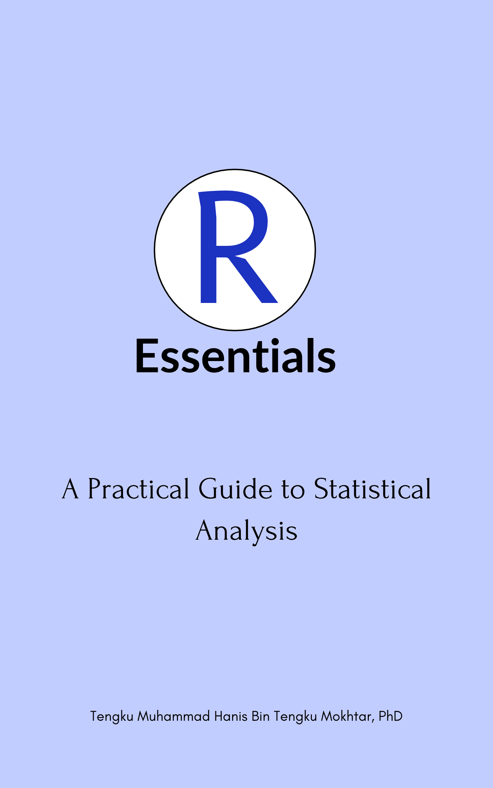

## **Abstract**

{width="40%"}

R Essentials: Applied Statistical Analysis is the second instalment in the R Essentials book series. Building upon the foundation established in the first book, [R Essentials: A Beginner’s Guide to Data Analysis](https://tengku-hanis.github.io/r_essential/), this book introduces readers to the fundamental concepts and practical applications of statistical analysis using R.

Designed with beginners in mind, the book adopts a hands-on and accessible approach to explaining statistical methods, balancing ease of understanding with sufficient depth to establish a solid foundation in applied statistics. It aims to bridge the gap between statistical concepts and their practical implementation, helping readers develop the skills and confidence to conduct data analysis independently using R.

As an open-source programming language, R provides an accessible and cost-effective environment for learning and performing statistical analysis. Although this book is currently in the early stages of development, a preliminary draft, including code implementations and learning materials, is freely available through [the author's GitHub page](https://tengku-hanis.github.io/r_essential_statistics/).