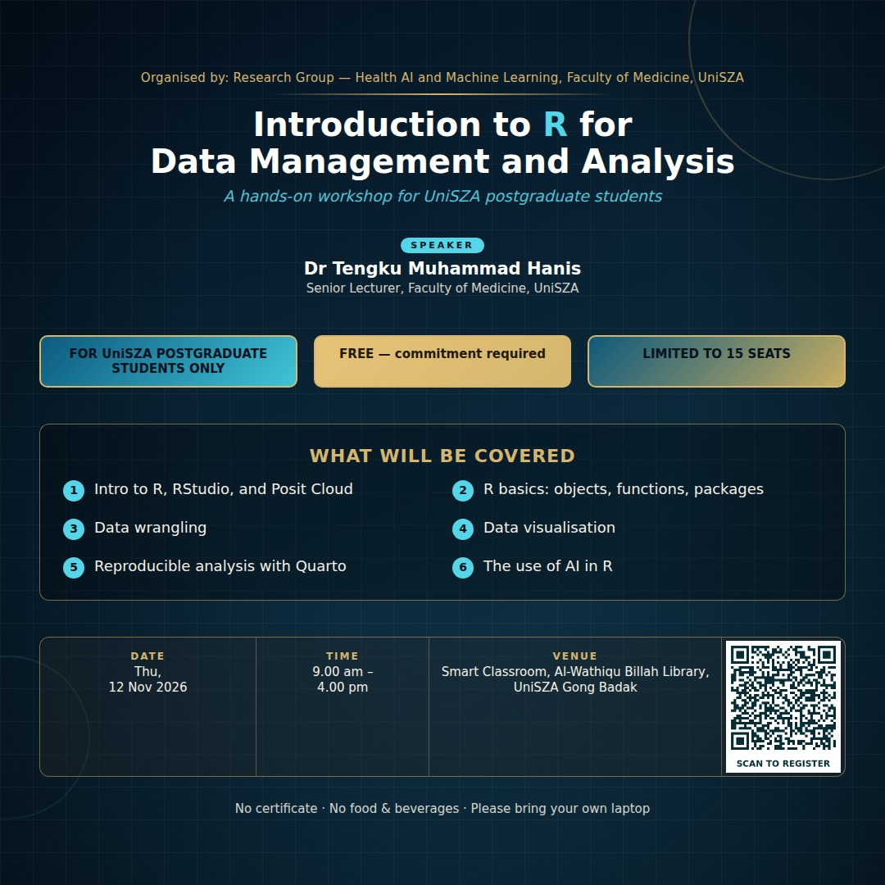

{width="70%"}

This workshop introduced postgraduate students with no prior coding experience to the R programming environment for data analysis. Seven sessions covered R fundamentals—data types, data structures, and the tidyverse ecosystem—including reading, cleaning, and managing missing values using naniar. Data wrangling focused on dplyr operations (select, filter, mutate, arrange, rename) and reshaping with pivot_longer/pivot_wider. Descriptive statistics were explored via skimr, summarytools, and gtsummary. Visualisation was taught through both base R plots (histograms, bar charts, boxplots, scatter plots) and ggplot2, with faceting and theming. The workshop also addressed reproducible research with Quarto, AI-assisted coding workflows in R, and hands-on exercises using real datasets (Pima Indians diabetes, USArrests). Participants gained practical skills to perform complete, documented data analyses independently.

-   Date: November 12, 2026
-   Location: Smart Classroom, Al-Wathiqu Billah Library, Universiti Sultan Zainal Abidin
-   Link: [ Material](https://github.com/tengku-hanis/intro2r_postgrad_unisza)
  